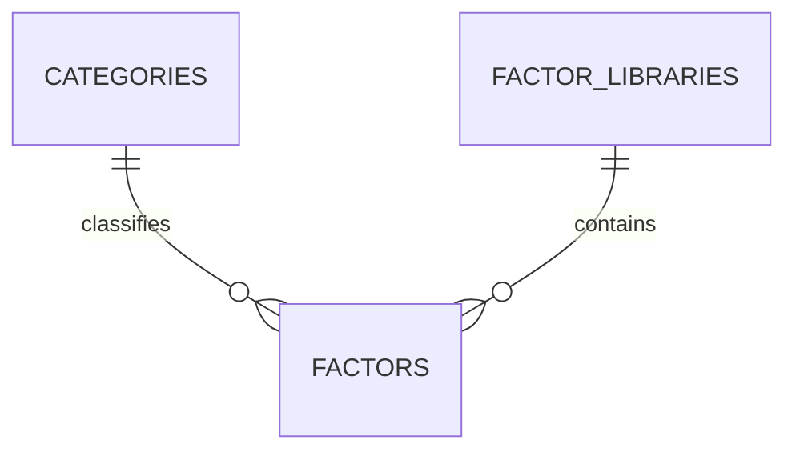

# ResearchEngine 数据库设计

> 2026-11-05：因子批量回测已移交 SVQuant，`factor_backtest.db` 与 `FactorBacktestStore` 已从 RE 删除；本文只描述仍由本仓库维护的因子资产库。历史 schema 见 `docs/归档/已移交-SVQuant/`。

## 1. 数据库信息

- 数据库类型：SQLite（本地因子资产）；另有可选 CSV、Parquet 和 ClickHouse 存储适配。
- 数据库名称：`factor_library.db`，路径由配置决定。
- 字符集：SQLite 文本使用 UTF-8。
- 时区：行情日期按交易日期保存。

---

## 2. 数据存储用途

| 存储 | 默认位置 | 保存内容 | 生命周期 |
|---|---|---|---|
| 外部 MarketData | `data.dir` 指向的仓库外目录 | 带 Manifest 的行情、状态和参考数据文件 | 由 MarketData 发布流程管理；ResearchEngine 只读 |
| 因子资产 SQLite | `assets.factor_database`，默认 `app/assets/factors/factor_library.db` | 分类、因子库目录和因子代码/元数据 | 随 ResearchEngine 代码及资产版本发布 |
| 回测字段缓存 | `cache.dir`，默认 `.runtime/backtest-cache` | 可重新读取/计算的缓存 | 有 TTL 和大小上限，可删除重建 |
| 单次结果存储 | 由请求/存储适配配置决定 | 指标、净值、因子值、持仓和元数据 | 可选输出 |

模拟盘结算（`/api/internal/paper-trading/settle`）是无状态计算：ResearchEngine 不建立账户、订单或结算表，不持久化响应；账户、持仓、订单、成交、净值和策略状态由 SVQuant PostgreSQL 保存。

MarketData 的实际文件 schema 和字段来源属于数据发布契约，由发布方维护，本仓库不复刻其定义；启动时以其 `data_manifest.yaml` 为准。当前 release 的版本、覆盖区间和可用字段快照见[数据清单](数据清单.md)，该页随数据版本切换同步更新。

---

## 3. ER 关系

上图为因子资产库内的外键关系；批量结果库已随功能移交 SVQuant，不再属于本仓库。

---

## 4. 表清单

### 因子资产库 `factor_library.db`

| 表名 | 用途 |
|---|---|
| `categories` | 因子分类编号、名称和描述 |
| `factor_libraries` | 可查询因子库名称和说明 |
| `factors` | 因子稳定 ID、名称、代码、分类和归属库 |
| `sqlite_sequence` | SQLite 自增主键维护表 |

---

## 5. 表结构

### `categories`

- 主键：`category_id`（`SV##` 格式）
- 唯一键：`category_name`
- 主要字段：`category_id TEXT NOT NULL`、`category_name TEXT NOT NULL`、`description TEXT NULL`

### `factor_libraries`

- 主键：`library_id INTEGER AUTOINCREMENT`
- 唯一键：`library_name`
- 主要字段：`library_id`、`library_name TEXT NOT NULL`、`description TEXT NULL`

### `factors`

- 主键：`sv_id`（稳定 `SV##_####` 编号）
- 唯一键：`(library_id, factor_name)`
- 外键：`library_id → factor_libraries.library_id`，删除受限；`category_id → categories.category_id`，删除受限。

| 字段 | 类型 | NULL | 说明 |
|---|---|---|---|
| `sv_id` | TEXT | NO | 稳定因子 ID |
| `library_id` | INTEGER | NO | 因子所属库 |
| `factor_name` | TEXT | NO | Python 因子方法名 |
| `factor_name_en` | TEXT | NO | 英文名称 |
| `factor_code` | TEXT | NO | 因子代码 |
| `category_id` | TEXT | NO | 因子分类 |
| `description` | TEXT | YES | 因子核心问题/说明 |

## 6. 索引设计

| 表 | 索引 | 字段 | 用途 |
|---|---|---|---|
| `factors` | 主键/唯一约束 | `sv_id`、`(library_id, factor_name)` | 资产身份与库内名称查询 |

外键检查由 SQLite `PRAGMA foreign_keys = ON` 启用。

---

## 7. 数据关系与一致性

- 因子必须关联一个存在的因子库和分类。
- 因子资产库由 Git/发布流程管理，不得用运行结果覆盖。

---

## 8. 数据生命周期

- 行情数据由外部发布系统生成、版本化和归档。ResearchEngine 不更新行情文件。
- 因子资产随代码和资产库版本发布；更改因子代码应更新对应资产版本。
- 字段缓存可按配置 TTL 和最大字节数淘汰，丢失后允许从只读 MarketData 重建。
- 普通单次因子任务状态只在进程内保留短时间，不等同于持久化回测历史。

---

## 9. 数据容量

日增量、年增量和总容量取决于外部行情发布频率；仓库没有容量 SLA。

---

## 10. 备份与恢复

- 行情发布按外部数据发布策略备份，ResearchEngine 不提供其备份工具。
- SQLite 使用 WAL 时，运行中的数据库应通过 SQLite 在线备份能力或停服后的受控流程备份；不要只复制主 `.db` 而忽略活跃 WAL。
- `factor_library.db` 可从同一代码/资产版本恢复。
- 缓存可直接删除重建；缓存不替代原始数据或回测历史。

---

## 11. 数据安全与字段语义

- 数据库当前不保存 AI API Key；Key 从本地配置读取，不得输出到日志或提交到 Git。
- 行情字段缺失保持为缺失，不默认填零或改写成业务状态。
- `up_and_down_status` 是涨跌停/停牌等交易状态信息，`listed_status` 是上市生命周期状态；前者为 NA 不表示退市。实际数据覆盖范围需查看对应 MarketData release。
- 退市判定以 `listed_status` 为准：`终止上市`/`退市整理`/`暂停上市` 为不可投资。因子与策略回测已强制按此剔除（白名单 `在市`/`ST`/`*ST`，无开关），因为退市后 OHLC 被前值填充成冻结价、会污染横截面。
- MarketData 目录只读，应用不得在行情发布路径写入缓存或结果。

表定义源码：[因子资产加载器](../../app/services/factor/sqlite_loader.py)。
