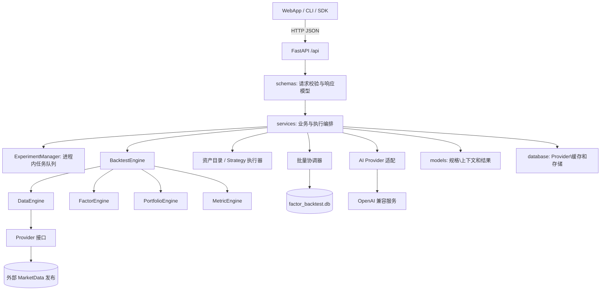
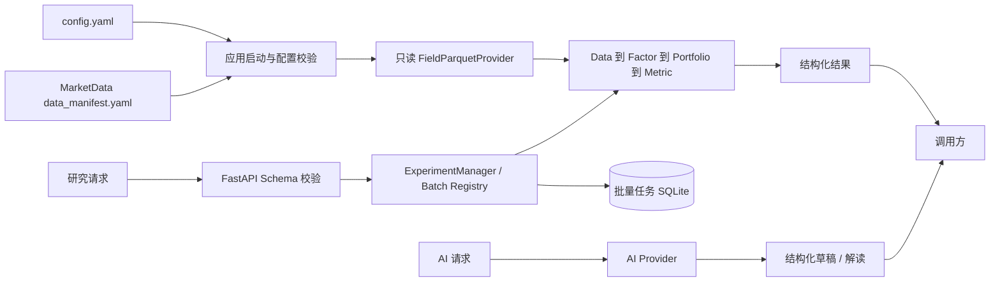

# ResearchEngine 系统架构设计

## 1. 文档信息

- 项目：ResearchEngine
- 架构负责人：仓库未登记
- 文档版本：1.0
- 日期：2026-09-21
- 状态：当前实现基线

---

## 2. 架构目标

本架构描述独立研究服务的系统边界、计算路径、数据所有权和运行约束，重点保证：

1. WebApp 等调用方通过稳定 HTTP 接口使用研究能力，不依赖本仓库内部 Python 模块。
2. 因子、策略、行情、批量任务和 AI 适配各自位于清楚的服务边界。
3. 回测结果可以关联请求规格、执行版本和 MarketData 发布版本。
4. 当前单进程实现的能力和扩容前置条件明确。

---

## 3. 系统范围

### 系统内部

- FastAPI 应用、API 路由和请求/响应 Schema。
- 因子、策略、数据、组合、指标和回测服务。
- 实验任务管理、批量回测协调和任务注册表。
- 配置、数据 Provider、缓存、SQLite 批量结果仓库和结果序列化。
- 随仓库发布的因子库、策略目录和公共因子工具。

### 外部系统

- SVQuant WebApp、CLI、SDK 或其他 HTTP 客户端。
- 通过文件系统挂载或本地路径提供的 MarketData 发布目录。
- 可选的 OpenAI 兼容 LLM Provider。
- 可选的 AkShare、Wind、ClickHouse 等 Provider/存储依赖；它们不是默认主路径。

### 系统边界

ResearchEngine 负责研究计算、已发布行情读取和研究 API。它不负责 Web 页面、用户/租户权限、券商连接、实盘交易或 MarketData 生产发布。WebApp 不导入 `app.*`，也不直接读取 ResearchEngine 的资产文件。

---

## 4. 核心领域对象

| 对象 | 含义 |
|---|---|
| `RuntimeSettings` | 从 `config.yaml` 校验并解析出的不可变运行设置 |
| `MarketDataRelease` / Manifest | 一组有版本标识、由清单描述的行情文件 |
| `FactorBacktestSpec` | 归一化、可追溯的因子回测输入规格 |
| `Experiment` / `ExperimentHandle` | 一次可提交给进程级 Manager 执行并查询状态的任务 |
| `FactorBacktestResult` | 因子计算、组合构造和指标分析后的标准结果 |
| Strategy request / signals | 策略输入与向量化目标权重或事件执行结果 |
| `FactorBacktestBatchProfile` | 批量回测的截止日期、筛选和预处理设定 |
| `batch_runs` / `factor_runs` | 批次及单因子任务的持久化状态与标量结果 |

对象之间的主调用关系：

```text
HTTP Request
    ↓
Experiment / FactorBacktestSpec
    ↓
BacktestEngine
    ├── DataEngine → MarketData Provider
    ├── FactorEngine
    ├── PortfolioEngine
    └── MetricEngine
    ↓
FactorBacktestResult → API Response
```

---

## 5. 总体架构



服务层由 FastAPI 路由、CLI 或 Python facade 调用；计算服务以 `models`、DataFrame/Series 和普通映射作为输入输出。数据库层提供行情 Provider、字段缓存和持久化，不反向依赖业务服务。

### 5.1 应用组成

| 模块 | 职责 | 输入 | 输出 |
|---|---|---|---|
| `app.api` / `app.schemas` | HTTP 适配、请求校验、响应序列化 | JSON 请求 | HTTP 状态和 JSON |
| `app.services.experiment` | 管理一次任务、并发、状态与取消 | `Experiment` | `ExperimentHandle` / 结果 |
| `app.services.backtest` | 编排因子回测完整计算链 | `FactorBacktestSpec`、共享行情上下文 | `FactorBacktestResult` |
| `app.services.data` | 数据读取、股票池、字段和状态过滤 | 数据请求、MarketData provider | 面板、字段、诊断信息 |
| `app.services.factor` | 因子来源加载、计算和预处理 | 因子规格、面板 | 因子值、计算诊断 |
| `app.services.portfolio` | 分组、权重、换仓和收益对齐 | 因子值、收盘价和组合规格 | 组合与收益输入 |
| `app.services.metric` | 计算收益、风险、IC 和扩展分析 | 组合和行情 | 指标、曲线和分析 |
| `app.services.strategy` | 向量化或事件策略执行 | 策略请求、行情 | 策略回测结果 |
| `app.services.factor_backtest_batch` | 批量任务协调、查询和重试 | 批量 profile | 批次任务和标量结果 |
| `app.services.catalog` | 因子和策略资产目录查询 | 资产索引/数据库 | 目录记录 |
| `app.api.ai_*` / `llm_provider` | 生成研究草稿和解释结果 | AI 请求、Provider 配置 | 校验后的草稿或解释 |
| `app.database` | Provider、字段缓存和结果存储 | 文件、SQLite 或可选外部存储 | 行情字段及持久化记录 |

---

## 6. 模块依赖关系

```text
api / cli
   ↓
services ─────→ models
   ↓               ↑
database ──────────┘
   ↓
外部行情 / SQLite / 文件存储
```

- `api` 负责 HTTP 细节，不实现因子、组合或指标算法。
- `services` 编排业务，不应依赖具体 FastAPI Request/Response 对象。
- `models` 保存运行设置、规格、上下文和结果结构，不依赖 Web 层和数据访问层。
- `database` 实现 Provider、缓存和持久化；业务通过服务接口使用它。
- `app.main` 是组合根，负责创建 Manager、数据服务、批量任务注册表并管理生命周期。
- 项目内公开 Python 命名空间统一为 `app.*`；当前实现不通过独立 QuantCore 包运行。

---

## 7. 数据流



行情以外部发布为只读输入；批量 SQLite 保存批次、单因子状态和标量指标；单次回测结果经 API 返回，结果存储适配器提供 CSV、Parquet 和 SQLite 能力。缓存位于本地文件系统，可重建，不作为业务数据源。

---

## 8. 核心业务流程

1. 启动时读取 `config.yaml`，校验数据清单及期望版本，并装载只读 Provider；随后启动后台行情发布监视器，按 release 签名变化自动重载，运行期数据发布切换不需要重启服务。
2. API 校验请求后，由 `ExperimentManager` 接收交互任务，或由批量 Task Registry 接收批次任务。
3. 因子回测进入 `BacktestEngine`，按数据、因子、组合和指标顺序执行；策略走相应策略执行链。
4. 单次因子任务由调用方轮询；策略端点等待任务完成后返回；批次通过独立任务和查询接口追踪。
5. AI 端点将请求交给配置的兼容 Provider，解析并校验输出后返回；不自动运行生成代码。

因子、批量和策略任务时序及状态见[流程设计](../模块设计/研究引擎/流程设计.md)。

---

## 9. 技术栈

| 类型 | 技术 |
|---|---|
| 后端 | Python 3.11、FastAPI、Uvicorn |
| 数值与面板 | Pandas、NumPy |
| 数据文件 | Parquet / PyArrow、CSV |
| 配置 | YAML / PyYAML |
| 内部数据库 | SQLite |
| 可选数据服务 | ClickHouse、AkShare、Wind 适配器 |
| 测试 | pytest、HTTPX |
| 部署 | Conda 环境、仓库后台控制脚本 |

---

## 10. 架构约束

- 正式服务由 `python -m app.main` 启动，Uvicorn 固定一个 Worker。
- `ExperimentManager` 默认并发数为 2、排队数为 8；部署配置可以调整。
- Manager 的任务 ID、Future、队列和缓存状态是进程内状态，不能跨实例查询或在进程重启后恢复。
- MarketData 发布目录必须在仓库外，应用按只读方式访问。
- 用户代码运行于服务进程当前环境；当前不提供容器或子进程沙箱。
- `/api` 是 HTTP 路径前缀，不表示已实现用户认证或 API 版本协商。

---

## 11. 性能设计

- 目标并发、响应时间和最大数据规模：仓库未定义 SLA。
- 回测并发受 `runtime.max_workers` 和有界 `runtime.max_queue_size` 控制；满载时请求快速失败。
- 字段读取可使用有大小和 TTL 限制的本地缓存；外部数据在任务需要时读取，不在服务启动时全量预热。
- 主要性能关注点是宽面板读取、滚动因子计算、组合构建和扩展指标；大规模性能结论应基于实际发布数据进行测量。

---

## 12. 安全设计

- 身份认证、权限控制和数据权限：当前未实现。
- CORS 当前允许任意来源（不允许凭据）；它不构成访问控制。
- AI API Key 通过本地 `config.yaml` 配置，配置文件被 Git 忽略；按功能的环境变量可覆盖共享配置。
- 生产部署应限制网络来源和可提交代码的 API 访问范围。不可将不受信任用户代码直接交给当前进程执行。
- 日志不得记录密钥；API Key 不应写入 Feature 文档、配置示例或提交内容。

---

## 13. 高可用与容错

| 情况 | 当前行为 |
|---|---|
| 配置、数据目录、清单或期望版本无效 | 应用启动失败，不进入健康状态 |
| 回测任务队列满 | 返回 `429`，调用方稍后重试 |
| 服务关闭 | 批量协调器先停止并等待，随后关闭实验 Manager 和数据引擎 |
| AI Provider 不可用 | 对应 AI 请求失败或返回结构化降级结果；不阻断普通回测 API |
| 单进程崩溃 | 进程内任务状态丢失；需由调用方重试，未实现自动恢复 |
| SQLite 不可用 | 批量查询或写入失败；单次行情读取本身不依赖批量 SQLite |

当前架构没有跨主机高可用、负载均衡或自动故障转移保证。

---

## 14. 架构风险

| 风险 | 影响 | 应对方向 |
|---|---|---|
| 进程内任务和状态 | 多 Worker 或多实例会出现状态与容量分裂 | 接入共享任务协调和独立 Worker 后再扩容 |
| 同进程执行用户代码 | 恶意或失控代码可影响服务资源 | 面向外部用户前增加隔离、超时和资源限额 |
| API 无认证 | 可访问服务的客户端可调用研究接口 | 在入口代理或应用层定义并实现认证授权 |
| 外部行情发布变化 | 字段缺失或版本错配会影响回测可复现性 | 固化 release、清单、字段覆盖和研究结果 provenance；后台按签名自动检测并原子切换 release |
| 没有性能 SLA | 无法判断容量是否满足生产负载 | 由产品和运维定义并以发布数据压测 |

---

## 15. 相关 ADR 和详细资料

- 历史架构展开稿：[ResearchEngine 架构设计 v1.4](../归档/架构历史/researchengine_architecture.md)
- 关键 ADR：[技术决策索引](../技术决策/README.md)
- 因子执行管线：ADR-018、ADR-025、ADR-028、ADR-029。
- 并发与持久化：ADR-019、ADR-020、ADR-021、ADR-022、ADR-023。
- API 根路径：ADR-024。
- Feature 级别需求与交付证据：[`docs/03-功能文档/`](../功能包/README.md)。

主要源码入口：[app/main.py](../../app/main.py)、[app/config.py](../../app/config.py)、[app/api/routes](../../app/api/routes)、[app/services](../../app/services)、[app/database](../../app/database)。
