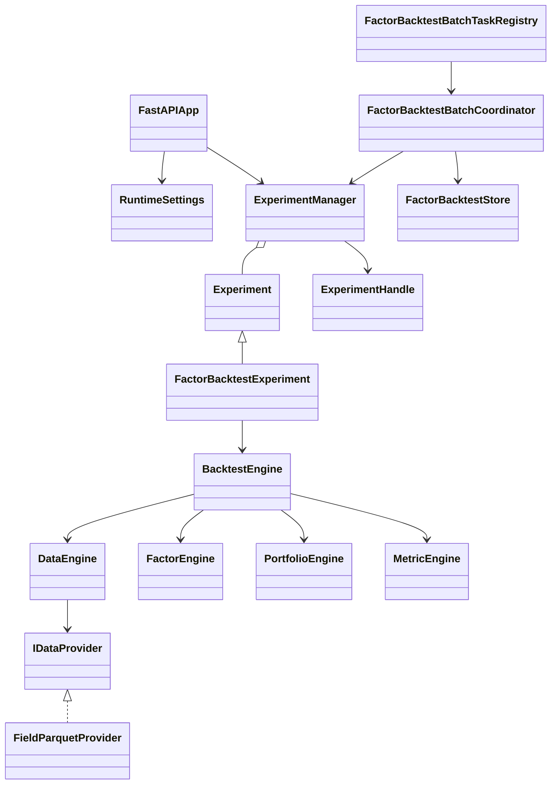

# ResearchEngine 类设计

## 1. 类关系图



## 2. 类清单

| 类 / 对象 | 职责 |
|---|---|
| `ConfigManager` | 读取 YAML/JSON 并提供原始配置访问 |
| `RuntimeSettings` | 保存校验后的不可变运行设置；API Key 字段不参与对象 repr |
| `Experiment` | 一次研究执行的抽象契约 |
| `ExperimentManager` | 进程级有界 FIFO、Worker、任务状态、去重和关闭 |
| `ExperimentHandle` | 为提交方提供任务 ID、Future、取消和状态快照 |
| `FactorBacktestExperiment` | 将因子规格和数据上下文交给因子回测主流程 |
| `BacktestEngine` | 编排 Data、Factor、Portfolio、Metric 四个服务 |
| `DataEngine` | 为计算服务提供行情和股票池访问接口 |
| `DataReleaseWatcher` | 检测行情 release 签名变化并原子重载数据来源 |
| `FactorEngine` | 加载/计算因子并执行预处理 |
| `PortfolioEngine` | 按因子与组合规格构建权重、持仓和收益输入 |
| `MetricEngine` | 计算回测及因子预测指标 |
| `IDataProvider` / `FieldParquetProvider` | 定义数据 Provider 契约并读取字段 Parquet 发布 |
| `FactorBacktestBatchTaskRegistry` | 接收、查询和关闭批量任务 |
| `FactorBacktestBatchCoordinator` | 遍历批次因子、协调执行、汇总状态与结果 |
| `FactorBacktestStore` | SQLite 批次、因子运行和标量指标持久化 |
| `ResultManager` | 在一次计算中承载指标、净值、持仓和序列化适配 |

## 3. 类详细设计

### 3.1 `RuntimeSettings`

#### 职责

- 将服务端、运行时、行情、资产、缓存、存储和 AI 配置映射为不可变对象。
- 使服务在启动时使用同一组已校验设置。

#### 关键属性

| 属性 | 类型 | 说明 |
|---|---|---|
| `project_root` / `config_path` | `Path` | 项目根路径和正式 YAML 路径 |
| `data_dir` / `data_manifest` | `Path` | 外部数据目录和发布清单 |
| `expected_data_version` | `str \| None` | 允许启动的数据版本 |
| `max_workers` / `max_queue_size` | `int` | 实验线程和排队上限 |
| `factor_database` / `strategy_index` | `Path` | 资产目录路径 |
| `factor_backtest_database` | `Path` | 批量指标 SQLite 路径 |
| `ai_base_url` / `ai_model` | `str` | AI Provider 地址和模型 |
| `ai_api_key` | `str \| None` | 本地密钥；repr 隐藏，不得记录日志 |

#### 生命周期

由 `load_runtime_settings()` 从根目录 `config.yaml` 构造；正式应用 lifespan 启动时重新读取。

### 3.2 `ExperimentManager` 与 `ExperimentHandle`

#### 职责

- Manager 只接受 `Experiment` 实例，不接受任意 callable。
- 用 `max_workers + max_queue_size` 限制运行和等待任务总数。
- 保存任务 Future、状态、错误、创建/结束时间和任务去重键。
- Handle 为调用方提供 `result()`、`cancel()` 和 `snapshot()`。

#### 主要方法

| 方法 | 参数 | 返回值 | 说明 |
|---|---|---|---|
| `start()` | 无 | `ExperimentManager` | 启动固定数量的工作线程 |
| `submit()` | Experiment、key、lane、metadata | `ExperimentHandle` | 提交任务；同 key 的进行中任务可复用 |
| `get()` | `run_id` | Handle 或 `None` | 查找进程内任务 |
| `cancel()` | `run_id` | `bool` | 取消排队任务或标记运行任务取消请求 |
| `shutdown()` | wait、cancel_pending | `None` | 停止接收任务并关闭 Worker |

Manager 内部使用锁、队列和容量信号量保护状态。运行中 Python 线程不能安全强杀；终态任务快照约保留 60 秒。

### 3.3 `BacktestEngine` 与计算服务

`BacktestEngine.run(spec)` 是完整因子回测编排入口。它读取共享 `DataEngine`，创建 `FactorEngine`，随后调用 `PortfolioEngine` 和 `MetricEngine`，最终构造 `FactorBacktestResult`。四个 Engine 都是业务服务，不属于 HTTP Schema 或持久化模型。

| 服务 | 主要输入 | 主要输出 |
|---|---|---|
| `DataEngine` | 股票池、日期、字段请求 | 面板、可交易掩码、行情诊断 |
| `FactorEngine` | `FactorBacktestSpec`、市场字段 | 因子面板、预处理结果、数据诊断 |
| `PortfolioEngine` | 因子值、价格和组合参数 | 分组、目标权重、持仓、远期收益 |
| `MetricEngine` | 组合结果、基准和评估参数 | 收益、净值、预测指标和风险分析 |

策略回测由 `app.services.strategy` 的向量化或事件执行器处理，不经过因子 `BacktestEngine` 的主链。

### 3.4 批量回测类

- `FactorBacktestBatchTaskRegistry` 保存进程内批量任务句柄并控制 Registry 生命周期。
- `FactorBacktestBatchCoordinator` 根据 `FactorBacktestBatchProfile` 协调因子运行，并将结果写入 `FactorBacktestStore`。
- `FactorBacktestStore` 负责数据库 schema 初始化、批次和因子运行事务、查询索引及指标记录；不保存完整日频曲线。

## 4. 接口设计

### `Experiment`

```python
class Experiment:
    def run(self, context):
        """在 Manager Worker 中执行一次研究任务并返回结果。"""
```

实现包括因子回测实验及策略回测执行适配。具体输入类型和 API DTO 以 `app/services/experiment`、`app/models` 和 `app/schemas` 中的当前定义为准。

### `IDataProvider`

```python
class IDataProvider:
    def get_bars(self, ...): ...
    def get_panels(self, ...): ...
    def get_symbols(self, ...): ...
```

字段 Parquet、CSV、宽表 CSV、Parquet、AkShare、Wind 和 ClickHouse Provider 按具体能力实现该接口；正式 ResearchEngine 配置以当前发布目录的 Field Parquet Provider 为主。

## 5. 继承、组合和生命周期

- `FactorBacktestExperiment` 继承 `Experiment`。
- `ExperimentManager` 组合 Worker、队列、任务表和去重表；应用 lifespan 创建并关闭它。
- `BacktestEngine` 组合 `PortfolioEngine`、`MetricEngine`，并在执行时访问 `DataEngine` 与 `FactorEngine`。
- Provider 实现遵守 `IDataProvider` 接口；DataEngine 持有当前 Provider。
- 批量 Task Registry 负责批次任务的内存生命周期；SQLite Store 负责批次历史持久化，二者不能互相替代。

## 6. 线程安全

`ExperimentManager` 的任务表和容量管理有显式同步。行情发布按只读方式共享；可变任务对象不得跨实验共享。所有 Provider/缓存并发语义应以具体实现为准，不在本设计中将整个系统声明为无条件线程安全。

## 7. 设计约束

- 新服务逻辑放在 `app.services`；模型和规格放在 `app.models`；HTTP DTO 放在 `app.schemas`。
- 路由不自行创建线程池或绕过 Manager 执行任务。
- 数据访问和持久化通过 `app.database` 或对应服务接口完成。
- 当前用户策略代码是受信任输入；不把普通线程管理器误称为代码沙箱。

源码：[experiment/manager.py](../../../app/services/experiment/manager.py)、[backtest/engine.py](../../../app/services/backtest/engine.py)、[data/engine.py](../../../app/services/data/engine.py)、[factor_backtest_store.py](../../../app/database/factor_backtest_store.py)。
