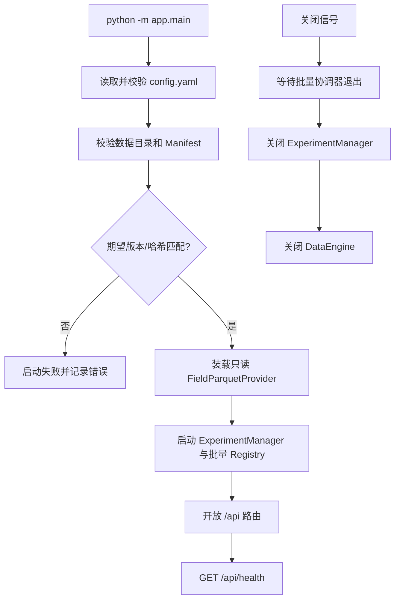
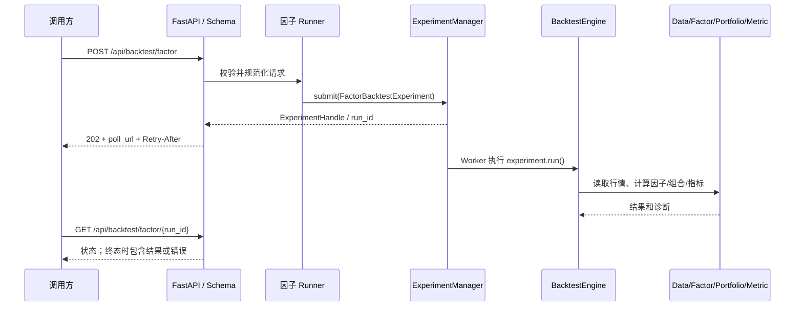

# ResearchEngine 流程设计

## 1. 流程说明

本流程描述应用启动、单次因子回测、策略回测和因子批量回测的运行时协作。

---

## 2. 参与模块

| 模块 | 职责 |
|---|---|
| `app.main` | 创建应用资源，校验配置/清单并管理启动关闭 |
| FastAPI Router / Schema | 接收 HTTP 请求并校验、返回响应 |
| `ExperimentManager` | 有界 FIFO 调度因子和策略 Experiment |
| `BacktestEngine` 与计算服务 | 执行因子回测计算链 |
| 策略执行器 | 执行向量化或事件策略 |
| Batch Task Registry / Coordinator | 接收和协调批量回测 |
| `FactorBacktestStore` | 保存批量任务历史和标量指标 |
| DataEngine / Provider | 从只读 MarketData 发布读取字段 |
| AI Provider Adapter | 向配置的 LLM 服务发送 AI 请求并校验输出 |

---

## 3. 正常流程

### 3.1 应用启动



步骤说明：

1. 正式运行从仓库根目录加载 `config.yaml`。
2. 根据配置定位外部行情数据和 `data_manifest.yaml`。
3. 验证 manifest 格式、文件存在性、期望数据版本和启用的哈希检查。
4. 任一启动校验失败时 lifespan 不进入服务可用阶段。
5. 停止时先等待批量协调任务，再关闭 Manager 和数据资源。

### 3.2 因子回测提交与轮询



步骤说明：

1. 请求经过 Pydantic Schema 和业务规则校验。
2. 因子 Runner 生成规格、身份键和 Experiment，并提交 Manager。
3. Manager 校验有界容量；相同进行中任务键可复用 Handle。
4. 因子端点立即返回 `202 Accepted`、`run_id`、`poll_url`，并给出 `Retry-After`。
5. 调用方轮询 GET 端点直至成功、失败或取消。
6. 因子终态快照只在当前进程短期保留，进程重启后不可查询。

### 3.3 策略回测

1. 调用方向 `POST /api/backtest/strategy` 提交策略规格。
2. 路由校验输入和策略能力，并将策略 Experiment 提交 Manager。
3. Manager Worker 执行对应向量化或事件策略。
4. 路由等待任务完成后同步返回 `StrategyBacktestResponse`。
5. 队列满或 Manager 关闭时分别返回 `429` 或 `503`。

### 3.4 批量因子回测

1. 调用方通过 `POST /api/internal/factor-backtest-batches` 提交批量 profile。
2. Registry 登记任务并返回批量 task ID 和轮询地址。
3. Coordinator 读取批次规格，协调因子计算，并将批次、因子状态及标量指标写入 SQLite。
4. 调用方轮询 task；完成后可查询批次、单因子运行和历史结果。
5. `dry_run` 用于执行前检查；`force_retry` 用于按接口契约显式重试。

---

## 4. 状态流转

### 单次 Experiment

```text
created → queued → running → succeeded
                            ├→ failed
                            └→ cancelled

队列已满 → rejected（不会创建可轮询任务）
```

| 状态 | 含义 |
|---|---|
| `created` | 任务记录已创建 |
| `queued` | 等待 Manager Worker |
| `running` | Worker 正在执行 |
| `succeeded` | 任务完成并生成结果 |
| `failed` | 执行发生错误 |
| `cancelled` | 尚未运行的任务已取消 |

对运行中的任务发起取消时，Manager 设置 `cancel_requested`；Python 线程继续运行，不能安全强杀。

### 批量任务

批量任务的进程内状态由 Task Registry 管理；持久化批次及因子行由 SQLite Store 维护。批量执行状态字段和查询返回以批量 API Schema 为准。

---

## 5. 异常流程

| 发生条件 | 处理方式 |
|---|---|
| 正式配置缺失或无效 | 启动失败，日志指出配置问题 |
| 行情清单、版本或文件校验失败 | 启动失败，不开放健康状态 |
| 请求 Schema 或业务参数不合法 | 拒绝请求，返回 API 错误响应 |
| Manager 队列达到容量上限 | 返回 `429`，客户端稍后重试 |
| 任务不存在或超过内存保留期 | 查询返回 `404` |
| 回测字段缺失或数据为空 | 任务失败并给出数据/计算错误 |
| AI Provider 超时或返回无效文本 | 仅 AI 请求失败或降级，不改变回测状态 |
| SQLite 写入失败 | 批量任务/查询报错；不伪装成成功持久化 |

---

## 6. 并发、幂等与重试

- 是否存在并发：是。单进程 Manager 运行多个 Worker，默认上限为 2；总排队容量默认 8。
- 并发策略：一个进程内有界 FIFO。正式 Uvicorn 启动固定一个 Worker。
- 因子任务去重：请求归一化后按任务键识别进行中的相同任务。
- 批量幂等：批次键包含批次规格和版本信息；强制重跑必须显式传参。
- 取消：可移除尚未开始的任务；运行中只记录取消请求。
- 超时和重试：没有通用的 HTTP 自动重试协议；调用方按响应的 `Retry-After` 和业务错误决定重试。批量重试走显式接口参数。

---

## 7. 流程约束

- 任务状态依赖当前进程，不能经负载均衡器随机路由到另一实例后继续轮询。
- 流程不包含持久化通用单次回测队列或服务重启恢复。
- 行情数据只读；缺失状态字段不自动解释为业务上的退市或停牌。
- AI 代码草稿不会自动进入上述回测流程；必须由调用方审核后显式提交。

更完整的历史时序图见 [FEAT-002 运行流程记录](../../../03-功能文档/FEAT-002-研究引擎/05-runtime-flow.md)；其中多实例拓扑、旧状态码和同步因子返回描述仅供历史追溯，当前基线以本页和[系统架构](../../架构文档/系统架构.md)为准。
